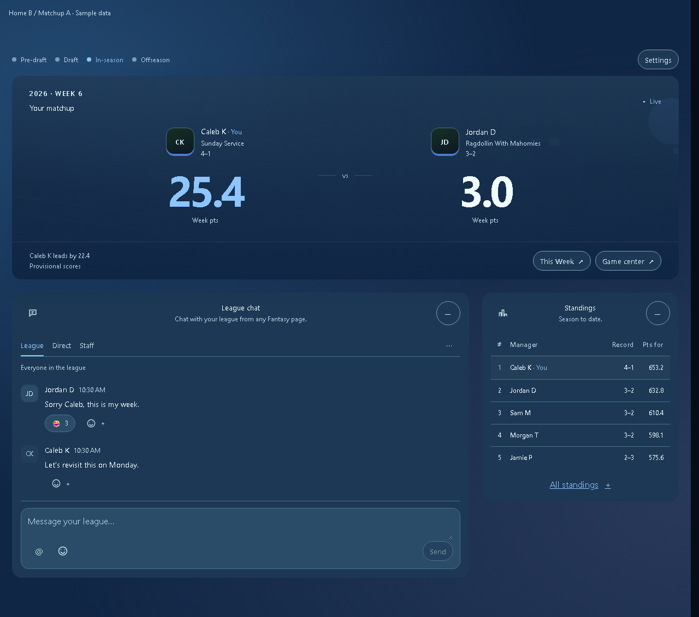
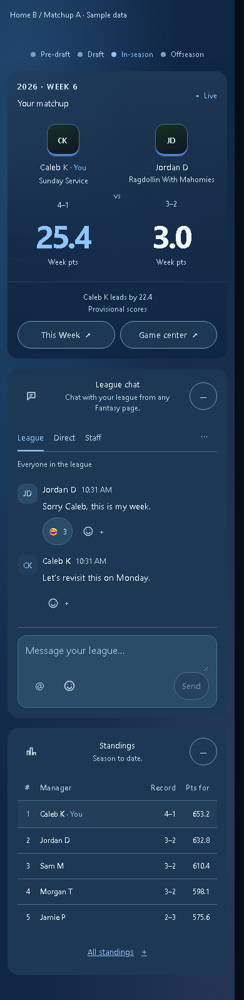
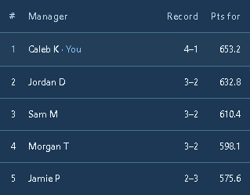

# Fantasy Home clubhouse and matchup polish A

The approved B clubhouse now uses the approved A banner duel: saved authenticated banners/crops, grouped identities, larger paired totals, and a quiet status/footer. Shared chat and compact standings remain below. Sample artwork and data exist only in static mocks and isolated browser fixtures.

## Implemented screenshots

| Desktop 1280 | Phone 390 |
| --- | --- |
|  |  |

## Shared spacing

Table cells now share 12px outer insets in every state, including packed numeric columns. The layout audit checks visible painted rows, chips and text controls for at least 8px inline and 4px block text clearance. It also considers nested labels and clipped content. Icon glyphs, hidden disclosures, unpainted links and small numeric counters retain their intended geometry. Game center position buttons fit long labels; phone duel rows retain the same inset when highlighted.

## Validation

| Check | Result |
| --- | --- |
| Frontend unit tests (`cd frontend; npm test`) | 1,336 passed |
| Product/living-surface/static-mock Python tests | 62 passed |
| Production frontend build | PASS |
| Home states and interactions | 30 passes: 10 states at 1280, 390 and 320 |
| Matchup palette, crop, long names and missing artwork | 12 passes at 1280, 390 and 320 |
| Home/header/menu scenarios | 21 passes |
| Cross-product inset audit | 58 passes: 29 fixture screens/states at 1280 and 390 |

Browser runners: `scripts/dev/fantasy_home_browser.mjs`, `fantasy_home_polish_browser.mjs`, `mobile_home_browser.mjs`, and `content_insets_browser.mjs`. All bundle production components with isolated data and block real API/network writes. The inset runner's `--before` mode reproduces the original Home/Insights/Game center edge failures against commit `51b9a216`.

Cross-product checks cover Home, This Week, My team/lineup, Free agents, Trades, Rosters, Rules, roster management/contracts/access/salary sheets, Insights, Vibes, DFS, Weekly projections, Game center, draft controls, Account, Admin and product headers. Full layout metrics also passed except two primary actions in the deliberately combined draft-controls harness; this is recorded separately from inset results. The full live Draft, Strategy, Cap, Best ball, Season projections, Model accuracy and all hidden admin/import/detail dialogs were not exercised in this spacing pass. No live league data or backend implementation changed; the full backend suite was not run.

`interactions.json`, `polish-review.json`, and `inset-review.json` retain the audit evidence. Static A/B comparison thumbnails are design references; screenshots prefixed `implemented-` show the React implementation. Home and This Week navigation remain as shipped pending a separate product decision.
