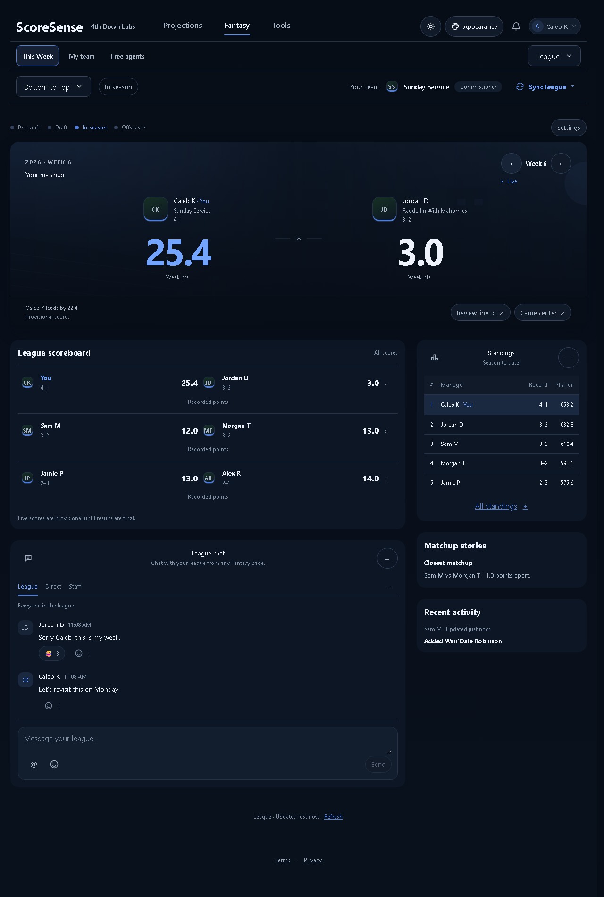
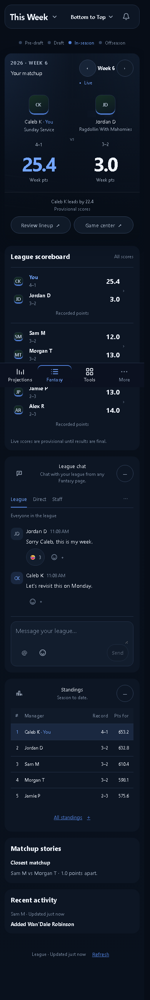

# Combined Fantasy landing page

Approved October 16, 2026. Home and This Week share one phase-aware landing page. Primary navigation calls it Home before the draft and This Week afterward. It appears once; League no longer repeats it. The internal id and canonical URL remain `home` and `/hub/home`. Old `/hub/week` links redirect with query and hash intact.

The approved A banner duel remains full width. League games and the full shared chat occupy the main column; standings, factual matchup stories and recorded public activity sit alongside. Phone stacks those sections. Review lineup opens My team for the displayed week. Every matchup link opens Game center with its selected team and week.

One scoring request owns all sections. The default retains Home's server-selected approaching week, while week controls and browser history support explicit browsing. Late responses from previous scopes are ignored. Failed refreshes retain the last snapshot; first-load failures offer Try again. Native pending-refresh recovery uses one visibility-aware timer. Native scores remain provisional until confirmed. The same projected-versus-recorded mode applies to the featured matchup, league games and stories.

## Screenshots

| Desktop 1280 | Phone 390 |
| --- | --- |
|  |  |

[Narrow phone 320](combined-320.png) · [Pre-draft phone](pre-draft-390.png)

## Validation

| Check | Result |
| --- | --- |
| Full frontend unit suite, including .mjs files and layout-audit tests | 1,341 passed |
| Product, living-surface and static frontend Python checks | 63 passed |
| Production build | PASS |
| Actual AppRouter + Fantasy workspace | 13 audit passes at 1280, 390 and 320 |
| Home states, chat and standings interactions | 30 passes at 1280, 390 and 320 |
| Saved artwork/crops, palette, long names and missing art | 12 passes |
| Shared Home header and menu scenarios | 21 passes |
| Migrated weekly states and My team lineup save | 29 audit passes; Game center and linked-lineup handoffs also exercised |

`fantasy_landing_browser.mjs` exercises the actual AppRouter and workspace: legacy redirect/query/hash, one landing nav item, selected week, history back/forward, other-team Game center links, own lineup links, one scoring request, refresh failure/recovery, initial error/retry, late response rejection, native pending recovery, true zero, hidden polling backoff and pre-draft layout. `fantasy_home_browser.mjs`, `fantasy_home_polish_browser.mjs`, `mobile_home_browser.mjs` and `week_overview_browser.mjs` cover other states and interactions. Browser fixtures intercept all network requests and keep writes in memory. No real league focus or lineup writes occur.

The Python checks are `tests/test_product_constitution.py`, `tests/test_living_surfaces.py` and `tests/test_frontend_static.py`, run with `PYTHONPATH=.`. No backend implementation changed; full backend tests and real-league/provider integration were not run. Strategy, Cap, Trades, Free agents internals, live Draft, Insights internals, Projections and Tools were not re-exercised in this consolidation; their data/components were not changed.
