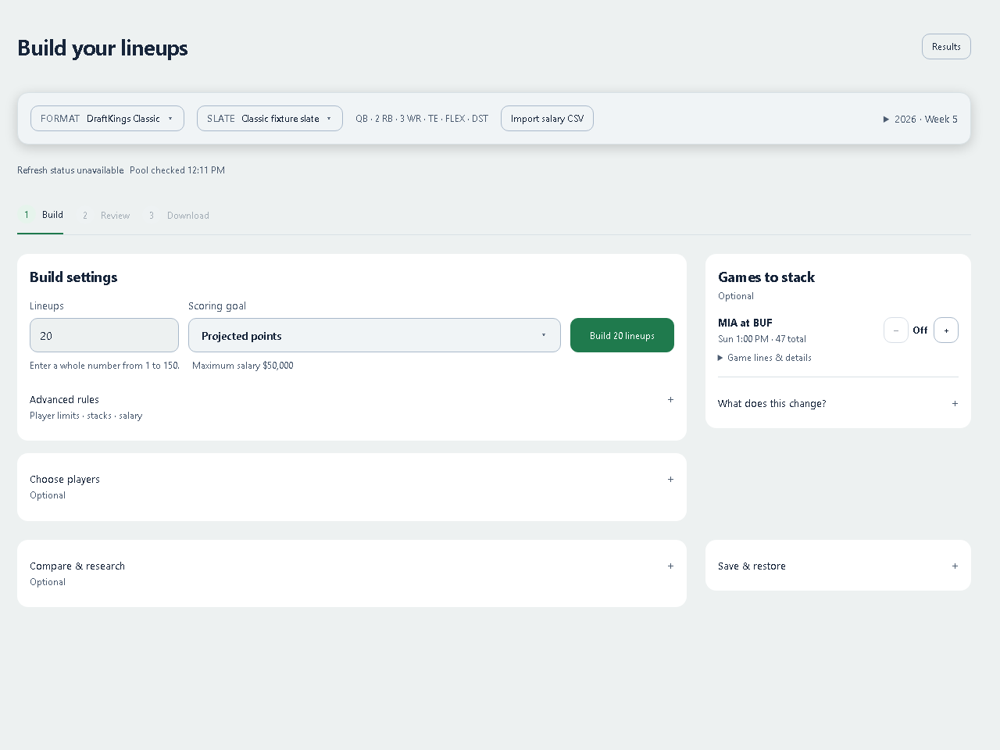
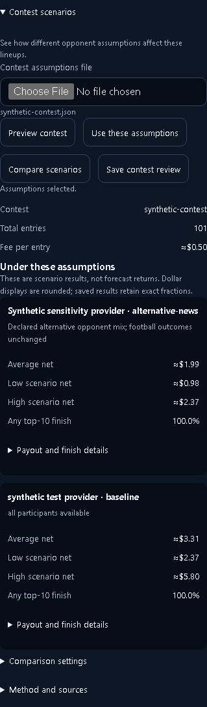
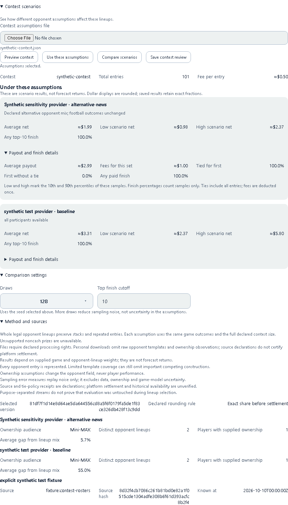

# Phase 6 review: supplied contest assumptions

Base: merged phase 5, `0ca877b4913dca8351da9db08304a0781dd4b2b7`. This draft adds read-only legal opponent fields, ownership-assumption sensitivity and exact conditional cash ties inside the approved guided DFS workspace. It does not deliver a fitted/calibrated field model or forecast EV. [Import/API contract](../DFS_CONTEST_RESEARCH_CONTRACT.md).

The new **Contest scenarios** disclosure starts closed inside Shared-game scenarios. It requires an explicitly selected current game bank and complete lineups, permitted input rights, an exact contest/full entrant count and a complete supplied cash schedule. Preview and selection precede comparison. Existing builds, exports, saved results and entries remain untouched. Failed imports/runs preserve the last review; new files clear the selected assumptions and label retained results as earlier reviews. Settings changes stale selection, and account changes clear research state.

## Actual validation

| Check | Actual result |
|---|---|
| Affected DFS, lineup and Vegas Python regression | **928 passed**, 65.49s; one existing Starlette/AnyIO deprecation warning |
| Final new feature + product/living-surface policy | **290 passed**, 7.90s; same warning; separate run, not added to 928 |
| Final product/living-surface docs check | **36 passed**, 3.02s; separate run |
| Full frontend | **1,207 passed / 3 known baseline failures of 1,210**, 14.128s |
| Scoped DFS frontend + layout audit unit tests | **280 passed**, 12.252s |
| Final production build | **Passed**, 7.27s; existing >500kB bundle warning |
| Production-component browser fixture | **6 size/theme cases**, **16 layout states**, **10 guard checks** passed |
| Existing guided workflow smoke, 390 dark | **Passed**: closed disclosures, exposure conflict, Build/Review/Download, sealed CSV and exact worker recovery |
| Specification integrity | Original SHA-256 unchanged: `a0cd7f50eed4f3a45d0158f587c2d00c1003c1b5425845a9bcfe9aa693fca96c` |

The three frontend failures are unchanged expectations in `auctionAwardContractLabel`, accuracy-null copy and the My team banner regex. No related production code was modified. No fresh whole-repository Python result, paid CI, live account/provider connection or platform settlement is claimed. Tests use isolated temporary files and mocked CPU boundaries, not the user's database.

The browser fixture bundles the actual production workspace, hook, worker and styles, then intercepts the exact fixture URL with actual pure-engine synthetic responses. All other network requests are blocked. It does not use another checkout's running app, external account or provider. Exact frozen requests and downloaded reports match the engine, including intentionally unsorted assumption IDs. Portfolio history is unchanged; raw opponent templates, ownership observations and game ledgers are absent from personal reports. Real background workers run. Rights denial occurs before any API request; invalid import, API failure, mismatched response, elapsed status, cancel/late response, stale settings, access denial and account reset are exercised.

| DFS surface | Dark | Light |
|---|---|---|
| 1280 desktop: compact Build and opened contest comparison | PASS | PASS |
| 390 phone: compact Build and opened contest comparison | PASS | PASS |
| 320 narrow phone | PASS | PASS |
| Expanded comparison/shared settings, payout details, method/source receipts | 390 + 320 PASS | 1280 + 320 PASS |

Both settings-row consumers use the same labeled field/menu primitive and `data-control-row` geometry check. Controls align at desktop height and stack on phone; source hashes wrap. Root and independent reviewer inspected the 1280 light and 390 dark expanded screenshots. Screenshots and [browser receipt](browser-verification.json) are curated here; detailed local logs remain under `outputs/`. Unchecked surfaces: unrelated Fantasy/Projections pages, authenticated live `/tools/dfs`, real platform exports/readback and real source-file ingestion.

## Synthetic engineering measurements

The constructed maximum replay-control case uses **750 pool players, 16 games, 32 profiles, 1,372 events, 150 own entries, four assumptions × 500 legal templates, 100,000 total entries and 256 draws**. All opponents are represented by multiplicity. It uses only two profiles per game and four payout tiers; it is not the maximum event-profile/tier payload.

The [final strict API request-model receipt](engine-request-verification.json) passed actual bounded parsing/IDs at **824,258 bytes**. Preparation took **0.610s** and one timed replay **24.917s**. A single run does not establish a latency percentile.

The separate earlier [core-engine repeated receipt](engine-core-verification.json) measured three same-dimension replays at **25.193 / 30.994 / 27.628s**, sample p50 **27.628s**, interpolated p95 **30.658s**. Its **823,961-byte core package** precedes the final API-ID/schema addition and has a different input hash. A separate traced replay measured **18,540,951 bytes** of Python heap, excluding preparation and process RSS. These are local warm-process measurements, not hosted latency or memory promises. The receipts are distinct; they are not combined as four repeats of one identical request.

## Correctness and remaining evidence

Tests cover legal Classic composition/salary/two-game membership, repeated roster weights, full multinomial multiplicities, provider/news separation, explicit unknown ownership, mutation/hash guards and frozen source/rights/time declarations. Cash tests use independent expanded-field oracles, the $170/3 tier-crossing tie with two own entries, unpaid ranks, nearby/negative scores, exact cents and declared rounding, fees once and compressed extreme-rank cases. A zero-event sensitivity oracle replays exact 10/101/100,000-entry counts without scaling ranks. All assumptions share game outcomes. These are engineering checks, not observed contest performance.

No permitted actual full-field/ownership archive or authenticated payout contract was supplied. Offline diagnostics can compare declared heldout player/pair, QB-attachment, bring-back, salary and repeated-construction frequencies, with chronological splits and explicit partial/full field coverage; no real diagnostic result is shipped. T21 remains partial. Source hashes, times and split attestations cannot authenticate provenance or prove untouched evaluation. USD cash-only declarations are supported; noncash settlement is unavailable. Automatic entrant-count uncertainty scenarios remain open, though separate exact-count packages can be evaluated.

Calibrated football outcomes, fitted contest fields, calibrated extreme ranks, future expected dollars and platform settlement remain unavailable. Phase 7 portfolio selection/risk/top-finish objectives and phase 8 accepted-entry late swap remain separate work. No merge, deploy, purchase, entry submission or live-lineup modification occurred.

## Reproduction

From the isolated checkout, set `PYTHONPATH=.` and use the existing project Python environment. Run the affected `tests/test_dfs*.py`, `tests/test_lineup*.py` and `tests/test_vegas*.py` modules. The five new contest modules plus product/living-surface policy reproduce the focused Python check. Frontend tests require explicit `.test.js`/`.test.mjs` enumeration on this Windows Node runtime; the directory launcher is not claimed as passing.

Generate the explicitly synthetic response file with `scripts/dev/build_dfs_contest_browser_fixture.py`. Run `node scripts/dev/dfs_contest_tasks.mjs` for the browser cases and `node scripts/dev/dfs_flow_tasks.mjs --smoke` for the retained export/recovery path. Both use an intercepted isolated production bundle and write local receipts/screenshots. `python scripts/dev/verify_dfs_contest_research.py --output outputs/contest-engineering.json --repeats 3` constructs the final strict engineering case; the optional separate heap run is slower. No external inputs or accounts are contacted.

## Screenshots

Default desktop Build:

Optional phone contest comparison:

Expanded desktop controls and sources:

