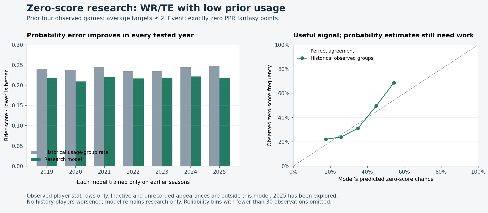

# DFS model accuracy: first evidence-based repair

This fixes a proven live-input timing defect and adds a reproducible historical evaluation. It does **not** claim a major point-accuracy improvement. A separate zero-score experiment shows useful signal for WR/TE players with prior usage, but fails for players without history and remains research-only.

No serving model was retrained or replaced. No live forecast, lineup, contest entry, league database or production artifact was changed. Build → Review → Download and existing exports/recovery are unchanged.

## What was fixed

Live forecasts advanced player averages through the last completed game while leaving derived usage trends and volatility at their previous-game values. RB carry-share trend and WR/TE target-share volatility therefore disagreed with the training inputs for the target game.

Completed profiles now advance declared derivatives with the **same four-pregame-average window** used in ETL. Both paths share the existing deterministic trend calculation. Missing observations stay missing; played zeros remain zeros. Older inputs without reconstruction sources expose a missing derivative instead of presenting stale usage as fresh. The shared input revision invalidates weekly, DFS, draft and ROS caches when this code is activated; no caches were regenerated here.

The regression fixtures fail on the old implementation and pass after the fix. Actual historical rows also match target-row training derivatives: all **12,875 RB/FB** and **28,598 WR/TE** source rows pass the parity audit.

## Historical data

The local files mixed older and newer feed cohorts, had an identical duplicate WR/TE game, and contained all-zero snap averages. They cannot reproduce the earlier October qualification reports, whose rebuilt datasets are absent locally. This evaluation does not substitute those files or quote old metrics as new evidence.

The isolated rebuild captures **26 public sources** for **2018–2025** from [nflverse player statistics](https://github.com/nflverse/nflverse-data/releases/tag/stats_player), [play-by-play](https://github.com/nflverse/nflverse-data/releases/tag/pbp), snap observations, schedules and an identity crosswalk. Every capture records its URL, retrieval time and SHA256. All **2,127 completed regular-season games** have PBP coverage; observed opponents match the schedules. No legacy feed fallback or duplicate skill-player game is accepted.

| Source cohort | Observed games | Recorded zeros | Recorded negatives |
|---|---:|---:|---:|
| QB | 5,092 | 81 | 276 |
| RB/FB | 12,875 | 1,730 | 150 |
| WR/TE | 28,598 | 5,671 | 103 |

There are 46,492 matched player/team snap observations. Unmatched observations and lagged cold-start gaps remain missing. Historical injury reports are unavailable; compatibility injury features are audited zeros, not evidence that players were healthy. Versioned pregame transformations use raw target quality and strictly prior defensive context; legacy globally normalized target quality is excluded from evaluation inputs.

The scoring target is PPR. This is an **observed-stat cohort**, not a complete catalog of active players, inactive weeks, zero-snap appearances or DFS salaries. Fetch timestamps describe this retrospective capture, not when the data was available before historical kickoff.

A separate 2025 participation audit finds **640 of 4,272** uniquely mapped WR/TE player/team games with positive offensive snaps (**14.98%**) absent from the weekly-stat feed at every position. They involve 208 players; 58 missing rows have at least 31 offensive snaps. Twelve rows with unresolved crosswalk identities are excluded, and 21 matches at another position are reported separately. These are **missing outcomes**, not invented zero scores. [Audit and source receipts](participation-coverage-2025.json), [reproducible calculation](participation_coverage_audit.py).

## Effect of the timing repair

Each 2019–2025 test year fits the unchanged model specification on earlier seasons only. Both arms use identical fitted heads, rows and inputs except the affected derivatives. This isolates the component defect; it does not replay present-day roster templates or historical injury overlays. Cold-start rows measure compatibility-imputed component inputs only.

| Tested pool | Games | Median MAE before | After | Paired 95% interval for change |
|---|---:|---:|---:|---|
| RB/FB, all observed | 11,319 | 4.297460 | 4.297734 | −0.001806 to +0.002353 |
| WR/TE, all observed | 25,236 | 4.137129 | 4.137726 | −0.000613 to +0.001831 |

The changes are negligible and both intervals include zero. Low-prior-usage point error improves slightly, also with intervals including zero. **Input parity is repaired; a meaningful point-accuracy gain is not established.** Per-season pinball losses, range coverage, weighted interval scores, bias and simple point baselines are retained in the generated reports. Signed average error of a median forecast is not mean-model validation.

## Zero-score research

The independent classifier predicts **exactly zero PPR points**, not zero targets, receptions or participation. It uses fixed regularized logistic regression and only prior-four-game scoring/usage plus WR/TE identity. Imputation and scaling fit on training seasons only. Baselines use training-only overall and prior-target-group zero rates. There is no class weighting, fitted quantile input or parameter sweep.

Low prior usage means average targets of at most two across the prior four observed games. Missing history forms its own cohort. Each fold predicts a later season; 2025 has already been explored and is **not an untouched holdout**. Paired uncertainty resamples whole season/week blocks, retaining the shared outcomes within a week.

| Cohort | Games | Usage-rate baseline Brier | Research Brier | Difference, 95% interval |
|---|---:|---:|---:|---|
| 2025, all observed WR/TE | 3,798 | 0.142785 | 0.129305 | −0.015372 to −0.011488 |
| 2025, known low prior usage | 1,475 | 0.248063 | 0.218145 | −0.034082 to −0.025226 |
| 2019–2025, unknown prior usage | 564 | 0.239642 | 0.242355 | +0.000430 to +0.005047 |

Brier score measures squared probability error; lower is better. The classifier beats both baselines on Brier score and log loss in all seven full-pool and known-low-usage yearly comparisons. For 2025 low usage, log loss falls from 0.68942 to 0.62738. But the unknown-history cohort worsens, and probability estimates still understate some zero risk: 2025 low-usage predictions average 39.97% against 43.59% observed zeros.



**Decision: no promotion or serving probability.** These results apply only to included stat rows. They cannot provide an unconditional chance for cheap roster players absent from that history. A complete participation cohort, a policy that abstains when history is absent, and later archived-forecast calibration are needed before exposing this as a DFS probability. Mean/tail accuracy under platform scoring and realized contest returns remain separate checks. No individual player's estimate was prescribed.

### Could this improve the median now?

A further exploratory probe uses the independently fitted zero-score signal only when prior scoring/target history exists: if the modeled zero mass is at least one half, set the median to zero and repair quantile ordering. The one-half threshold was fixed before measuring this probe; no head was refitted and no threshold was tuned. Unknown-history rows remain unchanged.

For 2025, all-observed MAE changes from 3.807751 to 3.803150; low-usage MAE changes from 2.170781 to 2.158937, with a paired interval of −0.020947 to −0.002657. The fixed reference actionable cohort (up to 60 WR and 24 TE per week) has MAE 5.525025 in both arms, with interval [0, 0]. Across all folds, 1,505 medians and 389 P10 values change; all P90 values and all 10,416 actionable-cohort rows remain unchanged.

The legacy composite screen improves in six of six required seasons, but the **stronger diagnostic gate fails** because actionable-cohort MAE and interval scores do not improve. This small low-usage gain does not qualify a replacement forecast. The candidate remains unpromoted. [Frozen calculation](hurdle_probe.py) and [independent rescoring checks](hurdle-probe-independent-checks.json) preserve the failed experiment, rather than relaxing its gate.

## Verification and receipts

[verification.json](verification.json) records actual checks and source hashes. [results.json](results.json) summarizes every tested fold and the relevant pooled diagnostics; it also hashes the fuller generated reports and saved row forecasts. [source-manifest.json](source-manifest.json) preserves the source capture and missing-input audits. Complete models, row forecasts and raw feeds remain in the isolated local `outputs/` directory and can be regenerated with the commands below. They are not installed as serving artifacts.

The final focused accuracy selection passes **196 tests** (6 dependency deprecation warnings, 20.38s). The scheduler module passes **37 tests** (3.88s) after its cadence fixture explicitly sets readiness and idle-worker conditions. Its previous real readiness lookup could fail and loop indefinitely before reaching the mocked cancellation. All original assertions remain. The old derived-input implementation fails all **13** new regression cases. These selections overlap the wider suite and their counts must not be added.

Tests use isolated database paths and block external sockets/DNS while allowing local Windows event-loop sockets. An initial full run stopped at that existing scheduler fixture; it is recorded as incomplete. No production scheduler logic changed.

The completed replacement full backend run reports **3,902 passed, 92 failed, 9 skipped, 7 warnings in 1,512.12s**. This is a failing full-suite result, not a green gate. Every failed node reproduces on the pristine base commit: 66 unavailable external-DNS lookups, 25 lineup/schedule-cache fixture assertions and one projection-context week assertion. The complete failed-node sets match with no missing or extra nodes. Per-node classifications, baseline log hashes and actual summaries are retained in the verification receipt; no newly introduced regression was observed.

Independent review found no remaining material causality or source-integrity defect. It independently rescored all 25,236 saved zero-score rows and matched the reported Brier/log losses. There are no frontend changes, so no new UI or layout verification is claimed. The original BUF–LAR 20-lineup audit was not reproduced.

## Reproduce locally

Run from the repository root with the existing Python environment. Use an isolated output directory; the source builder rejects serving-data/artifact destinations. The source capture needs public network access; fitting uses only captured files.

```powershell
$env:PYTHONPATH="."
$env:TESTING="1"
$env:SCORESENSE_TESTING="1"
.venv\Scripts\python scripts/analysis/prepare_dfs_accuracy_data.py --output-dir outputs/dfs-accuracy-data
.venv\Scripts\python -m src.analytics.dfs_serving_timing_eval --position rb --data-dir outputs/dfs-accuracy-data/processed --output-dir outputs/dfs-accuracy-impact/rb
.venv\Scripts\python -m src.analytics.dfs_serving_timing_eval --position wr --data-dir outputs/dfs-accuracy-data/processed --output-dir outputs/dfs-accuracy-impact/wr
.venv\Scripts\python -m src.analytics.dfs_zero_score_eval --data outputs/dfs-accuracy-data/processed/wr_mlready.parquet --output outputs/dfs-accuracy-zero/wr-observed-zero.json
.venv\Scripts\python docs/reviews/dfs-model-accuracy/hurdle_probe.py
.venv\Scripts\python docs/reviews/dfs-model-accuracy/participation_coverage_audit.py
```

No merge, deployment, data purchase or contest-entry action is part of this change.
