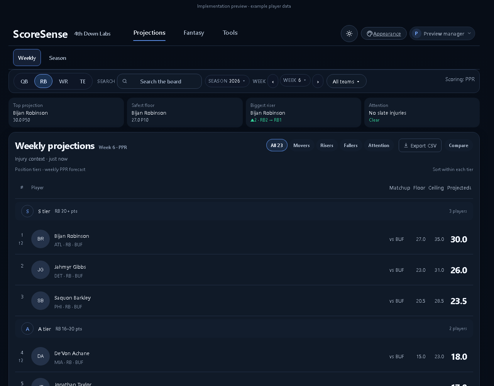
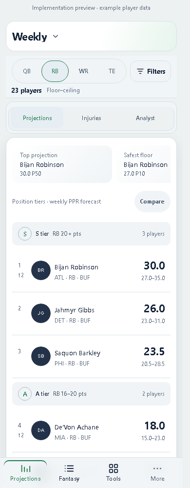
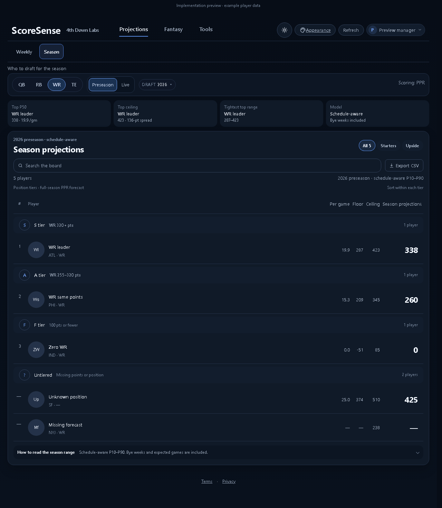
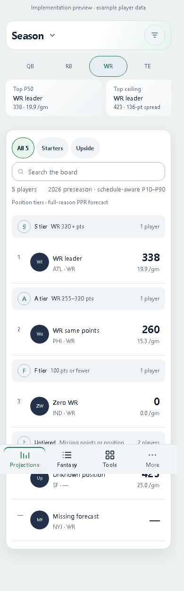

# Plain tier ranges

Production banners use readable point ranges such as **RB 16–20 pts**, with stronger range text. Hover details and screen-reader text retain the exact boundaries: at least 16 and below 20 points. D retains an exclusive lower cutoff; F remains open-ended. Classification and projections are unchanged.

| Fixture route | 1280 | 390 | 320 |
|---|---|---|---|
| Weekly | PASS | PASS | PASS |
| Season / Preseason | PASS | PASS | PASS |
| Season / Live | PASS | PASS | PASS |

54 layout measurements passed across normal, large-number, mixed-position, separate TE, player-detail, and recorded-season scenarios. Production components and full App routes use isolated example API fixtures; live API data was not rechecked. Desktop and phone screenshots were inspected.

Frontend suite: 1,316 passed (explicit test-file enumeration for Windows Node); production build passed. Product/living-surface/frontend-static pytest: 62 passed. Existing build chunk-size and dependency-deprecation warnings remain.

