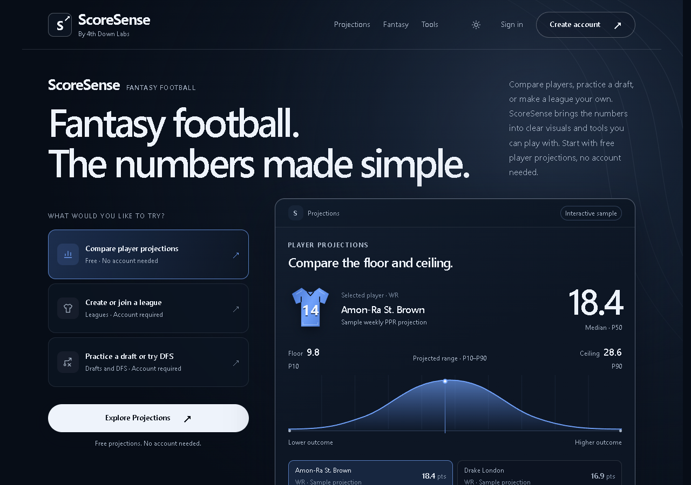
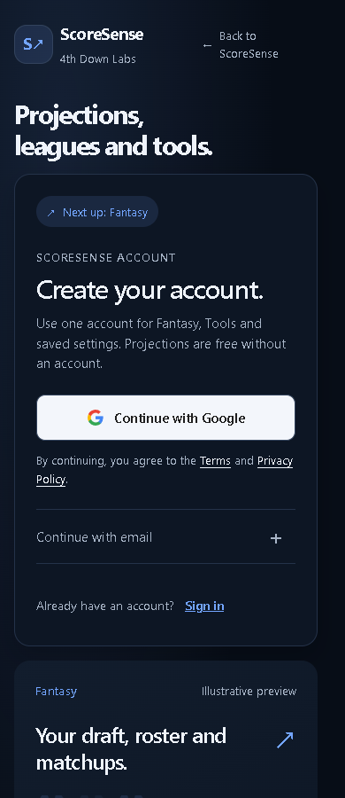

# ScoreSense public entry review references

These screenshots show the approved local preview at 1280px and 390px before its port onto the latest develop branch. Samples use illustrative football/product values; the signup reference uses fixture auth availability and creates no account. They are design references, not screenshots of the isolated rebased PR candidate. The rebased candidate retains newer appearance/recovery wrappers and is checked separately by source, frontend, backend and build tests. It has not been separately visually verified.

