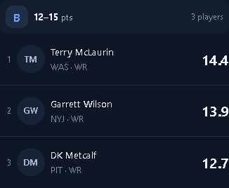
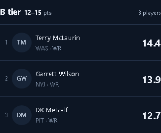
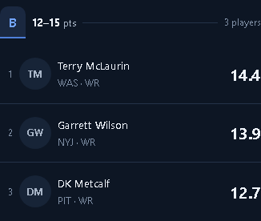

# Separate WR / TE projection boards and tier-banner options

October 14, 2026. Follow-up to merged PR #741. Weekly, full-season, ROS, and recorded season views now offer **QB / RB / WR / TE** rather than a combined WR/TE filter. Each receiver view has its own rows, ranks, leader signals, counts, and exports. WR/TE movement shows actual point deltas; shared-pool historical ranks are never relabeled as TE/WR rank changes. The shared WR model/artifact remains internal. Switching WR ↔ TE reuses the loaded pool and preserves the season/week context, without another forecast request.

Actual position decides inclusion. Unknown receiver identities remain visible as Untiered in either view without a position rank, rank movement, or leader signal. Missing/zero/negative forecasts and the open-ended F tier remain supported. No model forecasts, numerical tier thresholds, API contracts, league roster/Flex rules, or scoring changed. Standard scoring remains deferred. Other Fantasy/Tools position controls were not changed.

The existing player card remains centered on desktop and a bottom sheet on phones, with three in-season tabs, game log, small injury tag, bye handling, and concise notes/details. `pos=te` opens directly and query parameters round-trip independently of the model key. Shared position controls support radio semantics, arrow/Home/End navigation, and visible focus.

## Banner design previews

These are static design options in this PR, not a production banner replacement. The user leaned toward A's slim band and requested stronger, simpler range typography. The revised previews use **12–15 pts** instead of inequality notation, with medium-weight numbers, stronger contrast, and exact exclusive upper boundaries available in tooltips. Actual tier boundaries are unchanged.

- [Chooser](../../mockups/tier-banner-options.html)
- [A — slim band](../../mockups/tier-banner-a.html)
- [B — open heading](../../mockups/tier-banner-b.html)
- [C — tier tab](../../mockups/tier-banner-c.html)

The options reuse the mobile starter/shared foundation and existing theme tokens. Preview controls switch QB/RB/WR/TE and dark/light themes. Example names and point values are explicitly illustrative.

## Checks

| Surface | 1280 | 390 | 320 |
| --- | --- | --- | --- |
| Weekly / full season / ROS / recorded | PASS | PASS | PASS |
| WR ↔ TE switching and direct TE entry | PASS | PASS | PASS |
| Player card / details / bye card | PASS | PASS | PASS |
| Banner A / B / C / chooser, both themes | PASS | PASS | PASS |

- **120** passing production-App browser/layout measurements with isolated fixture APIs. Checked WR/TE click and keyboard selection, the phone filter sheet, filtered CSV, correct position tier labels, real-position card identity, unknown-position retention without leader/rank claims, direct TE entry, and no `/te` model endpoint or extra same-pool forecast request. Prior loading/error/missing/empty/very-large/completed/810-player cases and full F-tail export/reachability remain covered.
- **24** passing static mock measurements (four pages × three widths × two themes), plus position switching, exact tooltip boundaries, number weight, chooser links, and no page overflow. Selected desktop/phone screenshots visually inspected.
- **1,315** frontend/layout unit tests passed. The repository's stock `npm test` passes a directory argument rejected by the local Node runtime; the same complete `*.test.js` / `*.test.mjs` set was enumerated and run explicitly with the layout suite. No test was skipped to work around it.
- **62** product, living-surface, and frontend static pytest tests passed (one existing dependency deprecation warning).
- Production build and diff checks passed.

Production-App verification uses fixture responses, not live provider/authentication/league data. Model accuracy and Fantasy/Tools were not revalidated. No API writes were made. Banner selection is still a design review; no merge or deployment.

Reproduce: `node scripts/dev/projection_tiers_browser.mjs`; `node scripts/dev/tier_banners_browser.mjs` (serves branch mock files on an ephemeral local fixture server). Generated outputs stay under `outputs/`.

## Screenshots

| View | Desktop | Phone |
| --- | --- | --- |
| WR board | [1280](weekly-mixed-1280.png) | [390](weekly-mixed-390.png) |
| TE direct entry | [1280](weekly-te-direct-1280.png) | [390](weekly-te-direct-390.png) |
| Full-season TE | [1280](preseason-te-direct-1280.png) | [390](preseason-te-direct-390.png) |
| ROS TE | [1280](live-te-direct-1280.png) | [390](live-te-direct-390.png) |

[TE at 320](weekly-te-direct-320.png) · [Player details](weekly-details-390.png) · [Banner chooser](options-dark-1280.png) · [A dark](a-dark-390.png) · [A light](a-light-390.png)

### A

### B

### C

