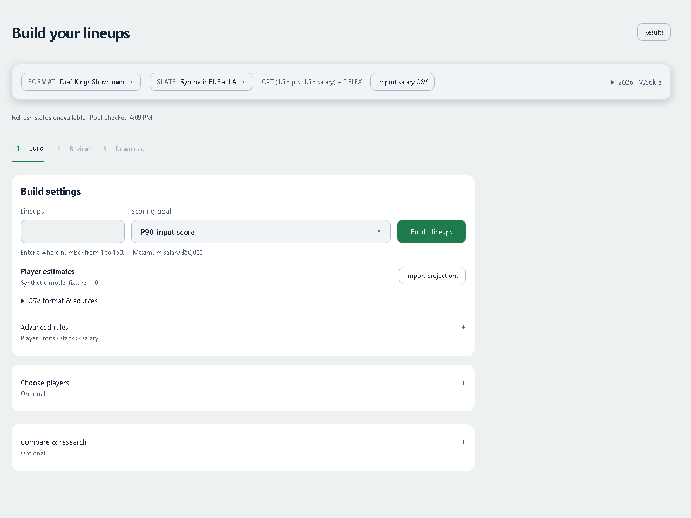
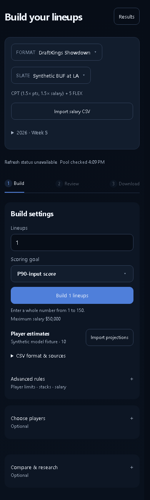
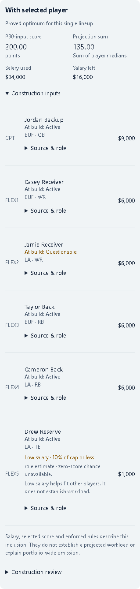

# Showdown workflow follow-up

Fixes the reported slate scope, frozen comparison and navigation failures while preserving Build → Review → Download. No player projections, trained models, contest entries or production data were changed.

## Confirmed causes and resulting behavior

- Salary matching left the full NFL projection pool attached. Fresh single-game API builds now freeze only the selected salary catalog, including players with missing estimates. Original salary coverage diagnostics remain available. Projection overrides are composed before filtering so otherwise valid league-wide imports remain compatible. Classic is unchanged.
- QB approval controls and warnings use exact selected salary identities. Comparison choices use the original frozen catalog, never a later live pool. LA/LAR aliases share an approval identity.
- Python hashed integral floats differently from integers; browser JSON changes `10.0` into `10` and `-0.0` into `0`. New single-game snapshots declare a numeric hash encoding that preserves identity through this boundary, including nested rules. Changed values, unknown encodings, unsafe numbers and oversized payloads still reject. Classic and legacy hash verification remain unchanged. An already round-tripped legacy snapshot cannot recover the lost representation; its error asks for a new build while retaining existing lineups.
- Unmounting DFS discarded its hook state. A bounded, account-scoped memory draft now restores slate, pool, strategy, imported estimates, frozen build, selected lineup, completed comparison, collection selection and Build/Review/Download stage on returning. Unchanged metadata refreshes retain completed comparisons; real input changes still invalidate them. It retains one account for up to eight hours and 32 MiB. Account changes clear it even while DFS is unmounted. Pending requests are cancelled; fresh pool responses cannot overwrite restored inputs. Entry templates, assignments, attestations, credentials and sealed export artifacts are excluded. Reload recovery remains explicit through the existing local portfolio draft and portable backups.
- Build shows estimate sources and a visible projection import action, with CSV guidance disclosed. Actual filename, import time and matched-player count travel with the working draft and the subsequent frozen build; no vendor or statistic is inferred from the filename.
- Low salary means base FLEX salary at or below 10% of the declared cap. When relevant evidence is missing, the roster visibly names availability, role or zero-score gaps above the closed source details. This is a review cue, not a player exclusion or a claim about workload. Explicit zero probabilities remain valid; booleans, arrays and missing values do not become zero.

## Verification

The actual checks and source hashes are recorded in [verification.json](verification.json). Browser evidence is in [browser-receipt.json](browser-receipt.json).

All affected DFS/Showdown/lineup/Vegas backend modules pass **1,432 tests**, with one existing Starlette deprecation warning, in **117.85 seconds**. This is the affected suite, not a new whole-repository backend run. Counts below overlap and must not be added together.

The focused backend suite passes 160 tests. The numeric round-trip regression independently fails twice against unchanged base `87bd9a511bded9584c8f886370b5f6c27a3e3b37` before the fix. Node performs the real JSON parse/stringify boundary; a forced FLEX comparison uses the actual Python solver for both supported single-game formats. A synthetic 800-player off-slate pool shrinks to its nine selected catalog rows, preserving a slate player with missing estimates.

The frontend suite passes 1,276 of 1,279 tests. The remaining three failures were independently reproduced on that exact unchanged base (three selected tests, three failures):

- `auctionAwardContractLabel describes locked rookie and vet deals`
- `accuracy copy names the miss, not a trust slogan`
- `My team keeps the approved summary above a flat roster`

No tests were weakened to conceal these failures. Product/living-surface checks pass 36 tests. The production build passes, with the existing bundle-size warning. Classic's production-control smoke check passes: guided flow, native exposure conflict, sealed CSV, preserved unrelated entry and exact worker backup recovery.

All browser API responses and assets are intercepted locally. Showdown results are computed synthetic engine fixtures. Browser tasks exercise slate filtering with 30 extra teams, frozen comparison, all three navigation stages, failed pool reads, import discovery/receipt retention, visible cheap-player gaps, account changes, status changes, cancellation, personal review reopening and supported CSV output.

| Layout | Light | Dark |
|---|---|---|
| 390 px | PASS | PASS |
| 768 px | PASS | PASS |
| 1280 px | PASS | PASS |

Build, Review and comparison use the shared layout measurements. Navigation-restored Review is also audited at 390 and 1280. Screenshots were inspected at phone and desktop widths. The synthetic host truly unmounts/remounts the production optimizer; this is not a hidden keep-alive or a claim that the complete deployed Projections route was exercised. Other Fantasy and Projections pages were not visually rechecked.

## Remaining evidence gaps

The user's two original 20-lineup BUF–LAR builds were not reproduced without their original exports and snapshots. Missing injury snapshots, current role estimates and zero-score probabilities remain unavailable. This change makes those limits visible; it does not establish accuracy for Hawes, Sherfield or any other player. Historical evaluation of means, medians, tails and low-usage players remains separate. No live account, platform acceptance, deployed code, purchases, contest entries, merges or deployments were tested or changed.
